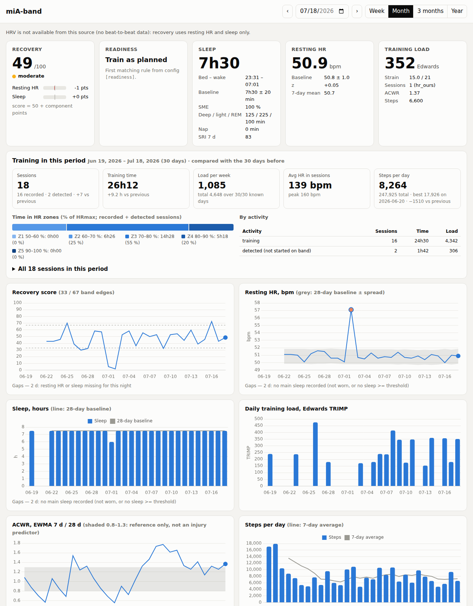

# miA-band

**Local-first health analytics for Xiaomi fitness bands.** It turns a raw device export into
WHOOP/Oura-style daily metrics: sleep, resting heart rate, training load, ACWR, recovery and
readiness. Every number is computed on your own machine, with documented, literature-based methods.


<sub>Dashboard on synthetic demo data.</sub>

## Why

Vendor apps keep health data in their cloud and compute scores with proprietary formulas. This
project:

- **Runs offline.** No account, no cloud, no network calls. Raw data never leaves the machine and
  is git-ignored by construction.
- **Uses published methods**, never imitated proprietary ones: Edwards and Banister TRIMP, EWMA
  ACWR, the Sleep Regularity Index, robust personal baselines. See [docs/METHODS.md](docs/METHODS.md).
- **Never invents data.** Gaps are reported with a reason (`band not worn`, `baseline warming up`,
  …) instead of being imputed. There is no "HRV" when the device provides no beat-to-beat data.
- **Explains every score.** Recovery splits exactly into per-component points, and readiness says
  which configurable rule fired.

## Features

| area | what you get |
|---|---|
| Sleep | total sleep, sleep maintenance efficiency, WASO, stages (when the device scores REM), naps, Sleep Regularity Index, bed/wake-time variability |
| Physiology | nightly resting HR (lowest rolling mean in sleep), 7- and 28-day baselines, deviation flags |
| Training | Edwards TRIMP per session from the app's own HR-zone computation, detection of sessions not started on the band, daily strain (0–21), EWMA ACWR |
| Recovery & readiness | 0–100 recovery score against personal baselines, with exact decomposition; ordered readiness rules from config |
| Activity | daily steps without double counting across devices |
| Dashboard | per-day cards; week/month/quarter/year training summary (sessions, time, load per week, time in HR zones, per activity, full session list); trend charts; light/dark; mobile layout |

## Engineering highlights

- **Layered pipeline:** source adapter → canonical schema → SQLite store → pure feature functions
  → daily metrics → CLI / FastAPI dashboard.
- **Idempotent ingestion:** upserts for point data, replace-by-window for intervals. Re-importing
  an overlapping full export is a no-op, and a night the device re-segmented leaves no orphans.
- **Time-zone correctness:** local time comes from the UTC offset recorded on each record, so
  travel and moves need no configuration. Nights across DST switches are correct, and devices
  that ignored DST are detected and fixed.
- **Self-verifying adapter:** sleep-stage codes are checked against the device's own per-stage
  totals on every import, and an unknown code aborts the import.
- **Device-aware baselines** restart when the sensor changes, so a new band never reads as a
  physiological change.
- **Tested against ground truth:** a scenario generator plants known events (short nights, illness,
  non-wear, DST, travel, device switches, unrecorded workouts), and the features must recover the
  exact expected values. The adapter is tested by a round trip through the export file format.
- **Privacy guard:** tests fail if a data file or an email address is committed, or if any
  tracked file contains a term from a local, git-ignored `.privacy-denylist`.

## Quick start

Requires Python ≥ 3.11.

```sh
python3 -m venv .venv && . .venv/bin/activate
pip install -e ".[dev]"
python -m pytest                       # synthetic-data test suite
python -m miaband demo                 # synthetic data into data/demo.sqlite, then a CLI summary
```

### With your own data (Mi Fitness export)

1. Request your data export in the Mi Fitness app, and unzip it into `data/mifitness/`. `data/`
   is git-ignored.
2. Copy `config.example.toml` to `config.toml` (also git-ignored) and set your age, sex and
   time zone.
3. Run:

```sh
python -m miaband import-mifitness            # idempotent: re-run on every new export
python -m miaband compute                     # full recompute of daily metrics
python -m miaband show --days 7               # CLI: last 7 days + recovery decomposition
python -m miaband show --date 2026-07-20      # same, as of any past day
python -m miaband sanity --days 30            # cross-checks against the device's own numbers
pip install -e ".[web]" && python -m miaband serve   # dashboard on http://127.0.0.1:8765
```

Not sure what's in an export? `scripts/inspect_mifitness.py` and `scripts/inspect_gadgetbridge.py`
profile an export before anything is imported. Their output redacts ids and never prints GPS
values. What is known about the Mi Fitness format is in
[docs/MIFITNESS_FORMAT.md](docs/MIFITNESS_FORMAT.md).

## Project layout

```
miaband/
  sources/      mifitness.py (adapter), synthetic.py (scenario generator)
  features/     timeutil, wear, nights, sleep, physiology, baselines, strain, recovery, activity
  canonical.py  schema    store.py  SQLite    pipeline.py  orchestration    cli.py
  web/          FastAPI app + static dashboard (Chart.js vendored, MIT)
scripts/        export inspectors (stdlib only)
tests/          pytest suite on synthetic scenarios
docs/           METHODS.md, MIFITNESS_FORMAT.md
```

## Limitations and roadmap

- **No HRV:** the Mi Fitness export contains no RR intervals. The schema has a table for them and the method is
  specified (METHODS §13); it gets implemented once a source provides RR data.
- **Gadgetbridge adapter:** next. The schema inspector exists; the adapter will plug into the
  same canonical schema.
- Wrist-based sleep staging and optical HR during arm-heavy sport have known accuracy limits.
  Scores describe trends against your own baseline; they are not medical advice.

## License

MIT, see [LICENSE](LICENSE). Chart.js is vendored under its own MIT license
(`miaband/web/static/chart.js.LICENSE.md`).
